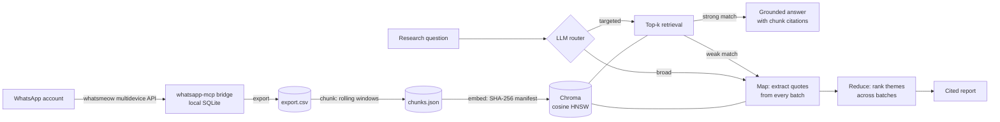

# chat-insight-engine

**Turn thousands of messy group-chat messages into grounded, cited research insight, on your own laptop.**

`chat-insight-engine` is a local-first retrieval-augmented generation (RAG) and map-reduce LLM pipeline for large WhatsApp
group chats. It pulls a group's history through an MCP-based WhatsApp bridge, indexes it as overlapping conversation
windows in a local vector store, and answers research questions with a verbatim quote and a `[chunk_id]` citation
for every claim. An LLM router decides per question whether to search a few relevant excerpts or read the whole corpus.

> **Real-world use.** Built to study a private community of UK NHS clinicians discussing AI and digital health:
> **5,250 messages from 172 participants**, indexed into **350 conversation chunks**, which produced four cited
> research reports (interoperability pain, manual workarounds, AI success stories, emerging tools).
> That data and those reports are private and **not** in this repository. Everything here runs on synthetic data.

[](https://github.com/AbhinavNair7/chat-insight-engine/actions/workflows/ci.yml)


---

## Highlights

- **Agentic query routing.** In `--auto` mode an LLM router classifies each question as *targeted* (top-k retrieval)
  or *broad* (full-corpus scan). If retrieval comes back with weak matches (cosine distance > 0.65), the engine
  escalates to a full scan on its own instead of answering from irrelevant context.
- **Map-reduce over the whole corpus.** Top-k RAG answers "what are the top frustrations?" from the 8 chunks it
  happened to retrieve. Scan mode reads *every* chunk instead: a cheap, high-throughput model extracts quoted evidence
  batch by batch, then a stronger model ranks themes by how many batches they recur in.
- **Grounding by construction.** Every chunk is labelled with its id. The prompt requires a citation for each claim,
  forbids facts that are not in the context, and has a fixed reply for "not enough evidence". `--find-quote` traces
  any quote back to the raw conversation around it.
- **Idempotent, cost-aware indexing.** A SHA-256 manifest records each chunk's text and embedding model, so re-runs
  only embed what changed. Chunks dropped by re-chunking are pruned, and a model switch rebuilds the index rather
  than mixing incomparable vectors. Scan batches default to a size that stays under typical per-minute token limits,
  chat calls back off exponentially on rate limits, and an unavailable model falls back automatically.
- **Local-first storage, explicit about what is sent.** The chat database, vector store and reports stay on disk, and
  Chroma telemetry is switched off. Be clear about what reaches the API: OpenAI embedding sends every chunk once,
  and a full scan sends every chunk to the chat model. With `--local-embeddings`, indexing and retrieval run fully
  offline and only targeted answers send their retrieved chunks.
- **Deterministic cross-check.** `chat-insight keywords` counts terms and bigrams with no LLM involved, so you can
  check whether an LLM-reported "top theme" really is frequent.

## Architecture



| Stage | Command | What happens |
|---|---|---|
| Ingest | `chat-insight export` | Reads the bridge's SQLite store read-only, checks the schema, finds the group, writes timestamps as ISO-8601 UTC |
| Chunk | `chat-insight chunk` | Rolling windows of N messages with configurable stride (overlap keeps threads together) |
| Index | `chat-insight embed` | Embeds new or changed chunks only (OpenAI or local sentence-transformers) and upserts them to Chroma |
| Ask | `chat-insight ask` | Cited RAG answers, full-corpus `--scan`, or `--auto` routing with escalation |
| Report | `chat-insight batch` | One markdown research report per question in a file; finished questions are skipped |
| Check | `chat-insight keywords` | Term and bigram frequencies, optionally limited to messages that express frustration |

## Design decisions

| Decision | Why |
|---|---|
| Chunk by **conversation window**, not by message | Single chat messages ("+1", "same here") carry no meaning alone. A window of ~30 consecutive messages keeps the question, the replies and the context together |
| **Map-reduce scan** next to RAG | Top-k retrieval is a biased sample for corpus-wide questions. Reading everything with a cheap model costs pennies and gives frequency-ranked themes |
| **Router plus distance-based escalation** | Users shouldn't need to know which strategy fits their question. Low retrieval confidence is a signal, not something to hide |
| **Temperature 0** and mandatory citations | Analysts need to reproduce and audit claims, so every finding traces back to a chunk and then to the raw messages |
| **Chroma persisted locally** | No server to run, and the index never leaves the laptop. That matters for a sensitive professional community |
| **Content-hash manifest** | Re-indexing after new messages arrive is incremental and safe to re-run |

## Quick start

No API key and no WhatsApp account needed: an offline demo on bundled synthetic data.

```bash
git clone https://github.com/AbhinavNair7/chat-insight-engine.git
cd chat-insight-engine
uv sync --extra local
uv run chat-insight demo
```

```text
✓  20 synthetic messages → 5 overlapping chunks (size 8, stride 4)
✓  Indexed 5 chunks in a temporary Chroma store

  Q: What are the concerns about AI replacing clinical judgement?
    1. [chunk_0004] 0.40 (good match)  [2025-01-06T10:52:00+00:00] member_2: Still copying results between the lab…
  …
  Q: What is slowing down AI adoption?
    1. [chunk_0002] 0.68 (poor match — retrieval may be irrelevant)  …
```

That last line is the signal `--auto` acts on. With an API key, a broad question on the same synthetic chat is
routed to a full scan and comes back as ranked, cited themes (abridged real output):

```text
$ chat-insight ask --auto -q "What are the top recurring themes across the whole group?"
  Router → full-corpus scan
  ...
### 3. Trust and Transparency in AI Outputs
- **Trust Issues**: "The key issue is hallucination. Clinicians need output they can trust" [chunk_0001].
- **Consent and Transparency**: "Consent and transparency are central to our deployment checklist" [chunk_0002].

### 4. AI Integration Challenges
- **Long Procurement**: "Procurement takes 18 months, by which time the product has changed twice" [chunk_0003].
- **Manual Data Entry**: "Still copying results between the lab system and the EPR by hand every morning" [chunk_0004].
```

## Running it on a real group

1. **Connect WhatsApp.** Clone and run the open-source
   [whatsapp-mcp](https://github.com/lharries/whatsapp-mcp) bridge into `./whatsapp-mcp`, then scan the QR code once:
   ```bash
   git clone https://github.com/lharries/whatsapp-mcp.git
   cd whatsapp-mcp/whatsapp-bridge && go run main.go
   ```
2. **Configure.** Run `cp .env.example .env`, then set `OPENAI_API_KEY`, `GROUP_NAME` and a `CORPUS_DESCRIPTION`.
   The description goes into every prompt, so the analyst knows what the corpus is.
3. **Build the index:**
   ```bash
   uv run chat-insight export            # → data/export.csv
   uv run chat-insight chunk             # → data/chunks.json
   uv run chat-insight embed             # → data/chroma (re-run any time; only new chunks are embedded)
   uv run chat-insight embed --status    # embedded / missing / stale
   ```
4. **Ask:**
   ```bash
   uv run chat-insight ask -q "Which ambient scribe tools have people trialled, and what went wrong?"
   uv run chat-insight ask --scan -q "What are the most common frustrations, ranked?"
   uv run chat-insight ask --auto                       # interactive, self-routing
   uv run chat-insight ask --dry-run -q "EPR integration"  # inspect retrieval and distances, no LLM call
   uv run chat-insight ask --find-quote "printing and re-scanning"
   uv run chat-insight batch --queries examples/questions.md   # → data/reports/*.md
   ```

Any group works. Change `CORPUS_DESCRIPTION` and write your own question file.

## Configuration

All settings are environment variables (see [`.env.example`](.env.example)) and most can also be set per command
with a flag (`--help` on any command).

| Variable | Default | Purpose |
|---|---|---|
| `OPENAI_API_KEY` | — | Embeddings, answers, scans |
| `CORPUS_DESCRIPTION` | NHS clinician group | Persona and context injected into every prompt |
| `GROUP_NAME` | — | Group to export (case-insensitive substring) |
| `CHUNK_SIZE` / `STRIDE` | `30` / `30` | Window size and step (stride < size gives overlap) |
| `EMBEDDING_MODEL` | `text-embedding-3-small` | Or `--local-embeddings` with `all-MiniLM-L6-v2` |
| `CHAT_MODEL` / `MAP_MODEL` | `gpt-4o` / `gpt-4o-mini` | Answer and reduce model / map and router model |
| `TOP_N` | `8` | Chunks retrieved per RAG query |
| `DATA_DIR` | `./data` | All generated artefacts (gitignored) |

## Development

```bash
uv sync
uv run pytest            # 106 tests, no network: SQLite fixtures, temp Chroma stores, a scripted fake LLM
uv run ruff check . && uv run ruff format --check .
```

The tests cover schema validation and group discovery, chunk coverage (no message lost or duplicated), manifest
idempotency end to end, router decisions, scan batching order, escalation on weak retrieval, and that dry runs
never call the LLM.

```
src/chat_insight/
├── cli.py          # `chat-insight <command>` dispatcher
├── export.py       # bridge SQLite → CSV
├── chunking.py     # rolling conversation windows
├── ingest.py       # idempotent embed + upsert, status, smoke test
├── embeddings.py   # OpenAI / sentence-transformers backends
├── store.py        # Chroma persistence helpers
├── query.py        # retrieval, grounded answers, router, quote finder
├── scan.py         # map-reduce full-corpus analysis
├── batch.py        # question file → one report per question
├── keywords.py     # deterministic frequency analysis
├── prompts.py      # all prompt templates in one place
└── demo.py         # offline synthetic demo
```

## Privacy and responsible use

Chat members haven't agreed to their messages being published. This project is built so that nothing they wrote has
to be: exports, indexes and reports live in the gitignored `data/` folder, the bridge's session keys are never read,
and this repository holds only code and synthetic examples. Using OpenAI models sends message text to OpenAI, as
described above. Check that this is acceptable for your group, or use `--local-embeddings` and keep LLM questions
targeted. Only analyse groups you belong to, follow the group's norms,
and don't publish quotes that could identify someone without their consent.

## Acknowledgements

WhatsApp ingestion builds on [lharries/whatsapp-mcp](https://github.com/lharries/whatsapp-mcp) (MIT), which uses
[whatsmeow](https://github.com/tulir/whatsmeow). This project is not affiliated with WhatsApp, Meta or the NHS.

## License

[MIT](LICENSE)
